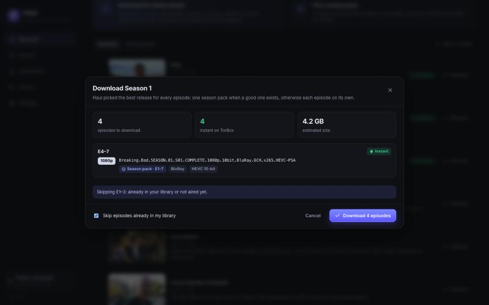
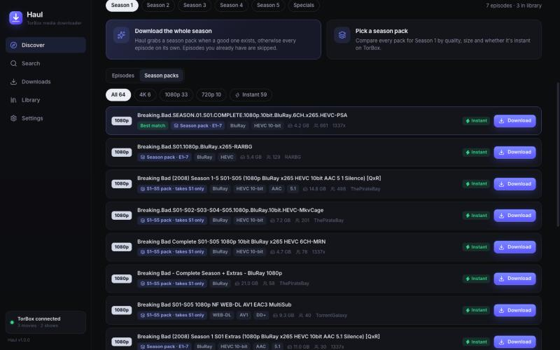

<p align="center"></p>

<h1 align="center">Haul</h1>

<p align="center"><b>Browse. Pick a season. It lands on your server.</b><br/>
An all-in-one TorBox media downloader with a built-in Nuvio / Stremio library addon.<br/>
No Sonarr, no Radarr, no Seerr, no rdt-client, no P2P on your server.</p>


## What it does

1. **Browse** a full movie and TV catalog (Cinemeta, no API key needed), with search, trending, new and top-rated rows.
2. **Choose exactly what you want** for a show:
   - **Download the whole season**: Haul grabs a season pack when a good one exists, otherwise every episode on its own, even when each episode is a separate torrent. Episodes you already have, and ones that haven't aired, are skipped. You see the plan (releases, size, how many are instant) before anything starts.
   - **Pick a season pack**: compare every pack by quality, HDR, codec, audio, size and seeders. Multi-season packs work too; Haul only takes the season you asked for.
   - **Single episodes**: open any episode and pick a release, or tick several and download just those.
   - **Movies**: the same release list, best match first.
3. **TorBox only.** Torrents are fetched by TorBox's servers. Haul then pulls the finished files to your server over HTTPS, a few at a time, with resume and retries. ⚡ *Instant* marks releases TorBox already has cached.
4. **Clean library.** Files are renamed for Plex, Jellyfin and Nuvio, and existing show and season folders are reused:
   ```
   TV Shows/Breaking Bad (2008)/Season 01/Breaking Bad (2008) - S01E04 - Cancer Man - 1080p.mkv
   Movies/Dune Part Two (2024)/Dune Part Two (2024) - 2160p.mkv
   ```
   Matching English subtitles are saved next to the video.
5. **Your personal media addon, built in.** Haul hosts your whole library (including folders you had before) as a Stremio-compatible addon. Install one URL in Nuvio and you get *My Shows*, *My Movies* and *Recently added* catalogs, plus a "Haul" stream on any title you own, served straight from disk with seeking. This replaces the old Personal Media Addon / Nuvi-Flow.

| Whole season | Season packs |
| --- | --- |
|  |  |
| **Show page** | **Library + Nuvio addon** |
|  |  |

## Install on ZimaOS (ThinkStation)

Open the ZimaOS terminal, become root (`sudo -i`) and run:

```bash
curl -fsSL https://raw.githubusercontent.com/Squipy411/haul/main/deploy/zimaos/install.sh | sh
```

This builds the image on the server, installs it as a ZimaOS app called **Haul**, and starts it on port **60700**. Run the same command again to update.

- Dashboard: `http://<server-ip>:60700`
- Settings and queue: `/DATA/AppData/haul/data`
- Media: `/DATA/Media/Movies` and `/DATA/Media/TV Shows` (change in Settings → Folders)

On first launch, paste your TorBox API key (torbox.app → Settings). That's the whole setup.

### Any other Docker host

```bash
docker run -d --name haul --restart unless-stopped -p 60700:60700 \
  -v ./haul-data:/data -v /path/to/Media:/media ghcr.io/squipy411/haul:latest
```

or use [docker-compose.yml](docker-compose.yml). Optional environment variables: `TORBOX_API_KEY`, `PUID`/`PGID` (owner of new files), `PUBLIC_URL`, `MOVIES_DIR`, `TV_DIR`, `INCOMPLETE_DIR`.

## Windows app

Download **Haul-Setup.exe** (installer) or **Haul-Portable.exe** from the [Releases](../../releases) page. Builds come from the *Windows app* workflow on every `v*` tag.

On first launch choose:

- **Connect to my Haul server**: the app is a window onto your ThinkStation (recommended).
- **Run Haul on this PC**: the full server runs inside the app and downloads to your Videos folder.

## Connect Nuvio

Library → **Copy URL**, then in Nuvio: Settings → Addons → install from URL. Keep the URL private; it includes a secret token. If it leaks, Settings → Nuvio addon → **New URL**.

If Nuvio reaches your server through a different address (Tailscale, a domain, HTTPS proxy), set Settings → Nuvio addon → *Public address* so stream links use it.

## Sources

Torrentio is on by default. TorBox's own search is used when reachable, and you can add any Stremio addon that returns torrents (for example Comet or MediaFusion without debrid). All results are merged, de-duplicated and checked against TorBox's cache in one call.

## Development

```bash
npm install
npm run dev          # API on :60700 and the dashboard on :5173
npm test             # parser, file-picking and byte-range tests
npm run build        # dist/server.mjs + dist/web
npm run desktop      # run the desktop app
npm run dist:win     # build the Windows installer
```

The server has no runtime dependencies: one bundled `dist/server.mjs` on Node 22+. State is kept in small JSON files in the data folder.

| Path | What it is |
| --- | --- |
| `server/search.ts` | Gathers torrents, checks the TorBox cache, ranks them and plans whole seasons |
| `server/jobs.ts` | Download queue: TorBox → server → library |
| `server/organize.ts` | Picks the right files from a pack and names them |
| `server/library.ts`, `server/addon.ts` | Library scanner and the Nuvio/Stremio addon |
| `web/src` | React dashboard |
| `desktop` | Electron shell for the Windows app |

## Credits

Byte-range streaming and the library-addon design come from [Personal Media Addon](https://github.com/Squipy411/personal-media-addon) (MIT). Catalog data comes from Cinemeta. Haul is not affiliated with TorBox, Nuvio or Stremio. Only download what you have the right to.
