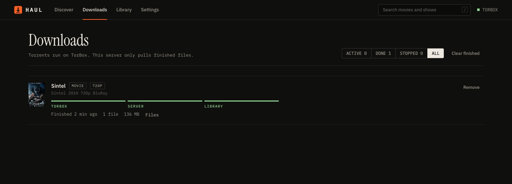

# Haul


A self-hosted downloader for films and series that runs everything through [TorBox](https://torbox.app). Pick a title, choose a season pack or let Haul assemble the whole season episode by episode, and the files arrive on your server, named the way Plex, Jellyfin and Nuvio expect. It also serves your library to Nuvio and Stremio as an addon.

It replaces a Sonarr + Radarr + Seerr + rdt-client stack for people who just want to choose what to download. Nothing is torrented on your own machine: TorBox fetches the torrent, Haul pulls the finished files over HTTPS.


## What you can do

- **Browse and search** films and series (catalog from Cinemeta, no API key).
- **Download a whole season.** Haul uses one season pack when a good one exists, otherwise it picks the best single-episode torrent for every episode. Episodes you already have and episodes that haven't aired are skipped. You see the plan before it starts.
- **Compare season packs** by resolution, source, HDR, codec, audio, size and seeders, and whether TorBox already has them cached. From a multi-season pack, only the season you asked for is downloaded.
- **Pick single episodes**, or tick several and download just those.
- **Films** get the same release table, best match first.
- **Follow progress** through TorBox → server → library, with pause, retry and cancel.
- **Host your library for Nuvio/Stremio**: catalogs for your series and films, and a "Haul" stream on any title you own, played straight from disk with seeking. This replaces Personal Media Addon / Nuvi-Flow.

| Season packs | Series page |
| --- | --- |
|  |  |
| **Library and Nuvio addon** | **Downloads** |
|  |  |

Files are saved like this, reusing show and season folders that already exist:

```
TV Shows/Breaking Bad (2008)/Season 01/Breaking Bad (2008) - S01E04 - Cancer Man - 1080p.mkv
Movies/Dune Part Two (2024)/Dune Part Two (2024) - 2160p.mkv
```

## Install on ZimaOS

In the ZimaOS terminal, as root (`sudo -i`):

```bash
curl -fsSL https://raw.githubusercontent.com/Squipy411/haul/main/deploy/zimaos/install.sh | sh
```

It builds the image on the server, registers Haul as a ZimaOS app (it appears on the dashboard) and starts it on port 60700. Run it again to update.

| | |
| --- | --- |
| Dashboard | `http://<server>:60700` |
| Settings, queue, library index | `/DATA/AppData/haul/data` |
| Media | `/DATA/Media/Movies` and `/DATA/Media/TV Shows` (changeable in Settings) |

On first open, paste your TorBox API key from torbox.app/settings.

### Other Docker hosts

```bash
docker run -d --name haul --restart unless-stopped -p 60700:60700 \
  -v ./haul-data:/data -v /path/to/Media:/media ghcr.io/squipy411/haul:latest
```

Or use [docker-compose.yml](docker-compose.yml). Optional environment: `TORBOX_API_KEY`, `PUID`/`PGID` (owner of new files), `PUBLIC_URL`, `MOVIES_DIR`, `TV_DIR`, `INCOMPLETE_DIR`.

## Windows app


Get **Haul-Setup.exe** or **Haul-Portable.exe** from [Releases](https://github.com/Squipy411/haul/releases). On first launch, choose:

- **My Haul server**: a window onto the server on your ThinkStation.
- **This PC**: Haul runs inside the app and downloads to your Videos folder.

*Haul → Change server…* in the menu switches later.

<br clear="right" />

## Nuvio

Library → **Copy URL**, then in Nuvio: Settings → Addons → install from URL. The URL contains a private token; if it leaks, make a new one in Settings → Nuvio addon. If Nuvio reaches the server through another address (Tailscale, a domain), set that as the public address so stream links use it.

## Sources

Torrentio is on by default. TorBox's own search is used when it answers, and you can add any Stremio addon that returns torrents (Comet or MediaFusion without debrid, for example). Results are merged, de-duplicated and checked against the TorBox cache in one request.

## Development

```bash
npm install
npm run dev        # API on :60700, dashboard with hot reload on :5173
npm test
npm run build      # dist/server.mjs and dist/web
npm run desktop    # Electron app from source
npm run dist:win   # Windows installer (on Windows; use dist:win:mac on a Mac)
```

The server is one bundled file with no runtime dependencies (Node 22+). State lives in small JSON files in the data folder.

| Path | |
| --- | --- |
| `server/search.ts` | Gathers torrents, checks the TorBox cache, ranks releases, plans whole seasons |
| `server/jobs.ts` | The queue: TorBox → server → library |
| `server/organize.ts` | Picks the right files out of a torrent and names them |
| `server/library.ts`, `server/addon.ts` | Library scanner and the Nuvio/Stremio addon |
| `web/src` | Dashboard (React) |
| `desktop` | Windows app (Electron) |

## Credits

Byte-range streaming and the addon design come from [Personal Media Addon](https://github.com/Squipy411/personal-media-addon) (MIT). Catalog data from Cinemeta. Not affiliated with TorBox, Nuvio or Stremio. Download only what you have the right to.
